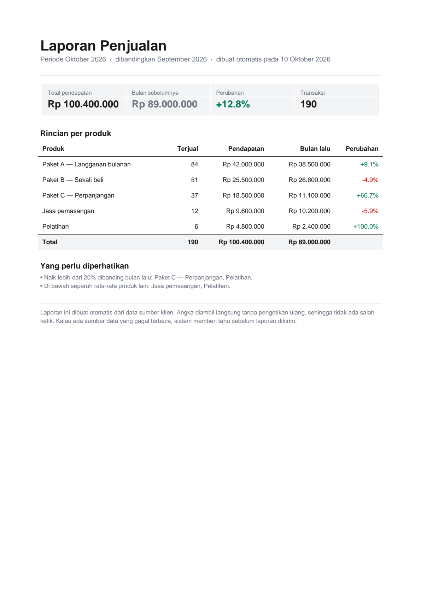

# Automated Business Report — demo

A working example of the reporting service: it builds a monthly business
report as a PDF, with a summary, a per-product table, and automatic notes
about anything unusual.

This is the same shape of report clients get — only the data source changes.

## See the output

Open [`contoh_laporan.pdf`](contoh_laporan.pdf) — that file is generated by
the script in this repo, not drawn by hand.



## Run it yourself

```bash
pip install reportlab
python buat_contoh.py my_report.pdf
```

No configuration, no network, no credentials. It writes the PDF next to itself.

## What the report contains

- **Summary cards** — total, previous month, change, transaction count
- **Per-product table** — sold, revenue, previous month, change
- **Automatic notes** — anything up or down more than 20%, and anything
  sitting far below the average
- **Footer** — states plainly where the numbers came from

## How the real thing differs

| Demo | Client version |
|---|---|
Hard-coded sample data | Your data source (Google Sheets, CSV, database, API) |
Run by hand | Runs on schedule |
Saved to a file | Emailed, or sent to Telegram |
Notes computed locally | Notes computed and delivered automatically |
| | Alerts you if a source fails |

## Notes on the code

`buat_contoh.py` is deliberately small and dependency-light: `reportlab` is the
only requirement. The report layout, the change calculation and the automatic
notes are all in one readable file — no framework, nothing to configure.

## License

MIT
